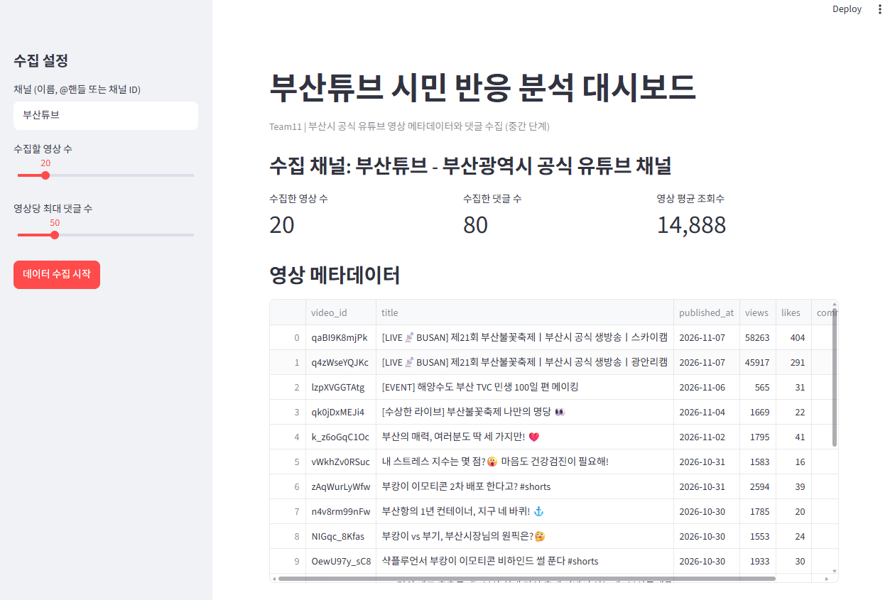

# 🌊 부산광역시 공식 유튜브('부산튜브') 시민 반응 및 소통 효과 분석

## 1. 프로젝트 소개
지자체(부산시) 공공 홍보 콘텐츠(정책 안내 vs 축제·관광 vs 숏폼)에 대한 시민 댓글 데이터를 수집하여, 시민 관심사와 정책 반응을 파악하는 Streamlit 웹 대시보드 프로젝트입니다.

## 2. 팀원 및 역할 분담
- **팀명**: team11
- **팀원**:
  - 팀원 1 (행정학과 / 202605110 / 라유리 ): 데이터 수집 (YouTube Data API 연동 및 익명화 전처리),Streamlit 대시보드 UI 구현
  - 팀원 2 (미디어커뮤니케이션학과 / 202606257 / 한지민): 텍스트 분석 (Kiwi 형태소 분석 및 감성 분석 모델 구축),발표 영상 제작

## 3. 실행 방법 (How to Run)
```bash
# 1. 저장소 복제
git clone [https://github.com/](https://github.com/)[내아이디]/[저장소이름].git

# 2. 필수 라이브러리 설치
pip install -r requirements.txt

# 3. Streamlit 앱 실행
streamlit run app.py
```

## 4. 사용 라이브러리
- `streamlit`: 대시보드 웹 애플리케이션 프레임워크
- `pandas`: 수집 데이터 가공 및 테이블 시각화
- `google-api-python-client`: YouTube Data API v3 연동

## 5. 앱 실행 화면 (중간 점검)

